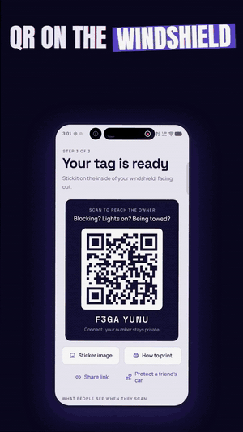
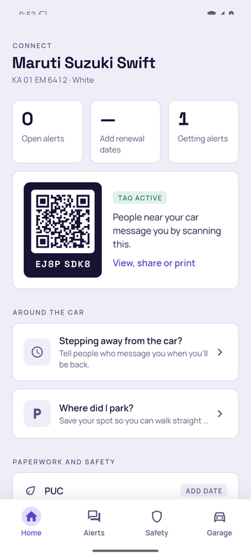
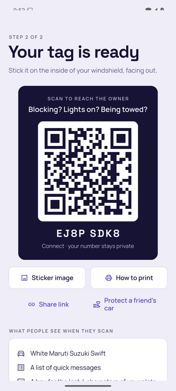
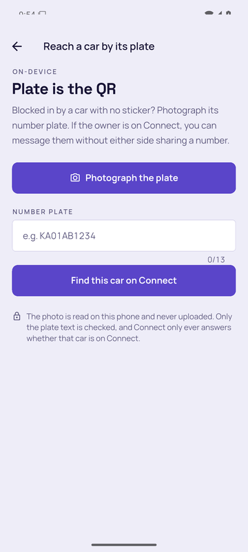
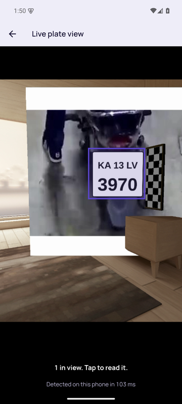
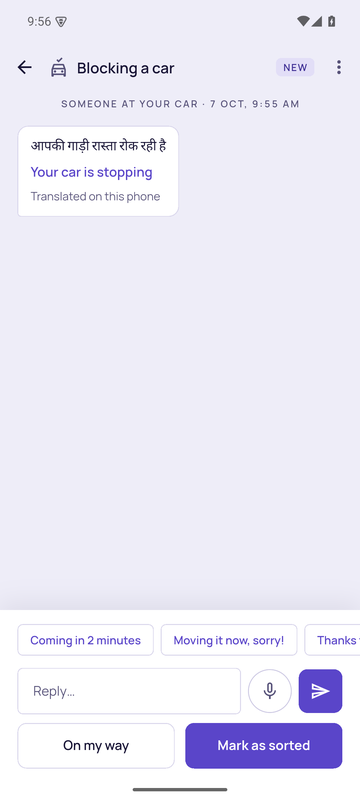
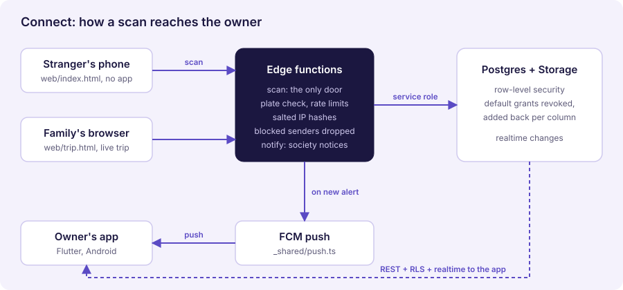

<div align="center">

# Connect
### Anyone can reach you about your car, without either side sharing a phone number.

    

<a href="https://youtube.com/shorts/r2QJgsw-6Nk"></a>

<sub>Scan, pick the problem, type the plate's last 4 characters, the owner is pinged, the owner replies. Animated walkthrough from the launch reel. ▶ [Watch the full reel on YouTube](https://youtube.com/shorts/r2QJgsw-6Nk).</sub>

</div>

A QR tag on the windshield turns "whose car is this?" into a private two-way chat. A stranger scans it with any phone camera (no app), says what's wrong (blocking a gate, lights on, being towed, an accident), proves they are standing at the car, and the owner and their family get the message instantly. Around that, the app gives owners reasons to open it every week: parking, renewals, fuel and service logs, family safety and live trip sharing.

| 139 | 146 | ₹0 / month | 3 |
|:---:|:---:|:---:|:---:|
| backend end-to-end checks (privacy, RLS, blocking, family, trips) | app tests, three decode real recordings of a phone speaker | running cost on free tiers | models we trained ourselves, all on-device |

<p align="center">
  
  
  
  
  
</p>
<p align="center"><sub>Home, the tag, plate-as-QR, the live view where our own detector boxes the plate, and an alert translated on the phone. Release build on an Android 15 emulator.</sub></p>

## How it works



| A stranger can see | A stranger never sees |
| --- | --- |
| Colour, make and model | The owner's name, number or address |
| The owner's replies in their own thread | The number plate (they type 4 characters; we only say yes or no) |
| "Back by", after the plate check | Other people's alerts or messages |
| Medical info, only on an accident and only if shared | Parking spot, documents, fuel log |
| A live trip, only via the owner's link | A trip's position after it ends |

## Decisions worth knowing

- **Strangers never touch a table.** One edge function, `scan`, is their only door. It checks the plate digits, rate-limits (5 alerts per sender per 10 minutes, 10 per tag per hour), hashes IPs with a secret salt and silently drops blocked senders.
- **Owners are anonymous, and still isolated.** No OTP, no sign-up form. Row-level security limits each account to its own rows, default grants are revoked and added back one column at a time.
- **Information is revealed late.** "Back by" only after the plate check, medical info only on an accident, trip positions only with the private link and only while the trip is live.
- **Personal logs never leave the phone**: parking, fuel and documents.
- **It still works with no signal.** Basements have none, so the app opens offline, queues messages, and a "say it with sound" mode sends the plate and the reason as about two seconds of audio (an 18.0 to 19.7 kHz band, then audible chirps) that any Connect phone nearby relays. The modem is our own, in plain Dart.
- **Models are ours, and scored honestly.** The plate reader (CRNN, 3.4 MB) gets 60.7% of 150 held-out real Indian plates exactly right, against 49.3% for ML Kit with the same repair rules. The detector reaches mAP50 0.73 on 47 real Indian photos. The damage model is modest (mAP50 0.40, four reliable classes) and its repair range is labelled an estimate, never a quote.

## Known gaps

- Push notifications need a Firebase project, which isn't switched on yet. Until then, alerts notify only while the app is alive.
- Sound link: measured on real phones (12 of 12 frames at full volume, 6 of 8 at 40 dB quieter), but two phones answering each other live has not been run yet. It needs the screen open.
- Crash detection (4 g threshold, 15 s cancel countdown) has not been validated against real crashes.
- Accounts live on one phone: reinstalling loses the car.
- Translations have not had a native-speaker review. The plate reader has not been scored on a large Indian set.

## Run it

```bash
git clone https://github.com/nikhilcherry/connect && cd connect
./connect up        # whole backend in Docker: Supabase, scan page, n8n (first run pulls ~2 GB)
./connect status    # services and URLs
node supabase/tests/e2e.mjs        # the 139 backend checks
cd app && flutter test             # the 146 app tests
```

Everything else (local development, a laptop demo behind a tunnel, deploying to your own Supabase, building the APK, every feature in detail) is in **[`docs/DETAILS.md`](docs/DETAILS.md)**.

<details>
<summary>Repository layout</summary>

```
app/        Flutter app (Android first): screens, services, widgets, on-device ML, l10n
web/        Scan page and live-trip viewer, static, 4 languages
supabase/   migrations (schema, RLS, grants, RPCs), edge functions (scan, notify), e2e tests
ml/         plate detector, plate reader and damage model: data, scores, limits
scripts/    demo-up.sh: the stack, functions, scan page and tunnel in one command
docs/       full details, demo runbook, roadmap
```

</details>
